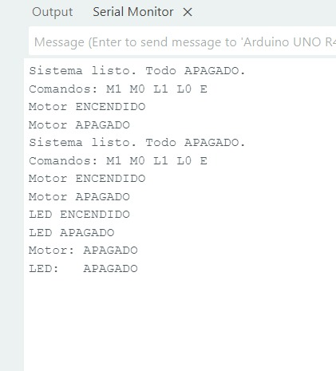

# Driver de software para un relevador

**Práctica 4.1.1-A** · Sistemas Programables · Ingeniería en Sistemas Computacionales
Instituto Tecnológico de Mazatlán · Profesor: Miguel Barrón Hernández

**Integrantes:** Ximena Armenta Dávila, Carlos Tadeo Ibarra Castañeda y Dulce Princesa Ulivarría González.

## Contexto

Un pin del Arduino UNO R4 WiFi entrega muy poca corriente, así que no puede alimentar un motor directamente: solo da la orden y un dispositivo intermedio (relevador o puente H) conmuta la carga. En esta práctica se programó un modelo de software de ese intermediario como una clase en C++ llamada `Relevador`, que recuerda su estado, traduce la orden a nivel activo en alto o en bajo, respeta un tiempo mínimo de 1000 ms entre cambios y arranca siempre apagada.

Como no se contaba con un módulo de relevadores, se usaron dos actuadores que lo representan, controlados por la misma clase desde el Monitor Serie (9600 baudios), con `millis()` y sin `delay()`:

| Actuador | Pin | Lógica |
|---|---|---|
| Motorreductor por puente H L298N (IN1) | D7 | Activo en ALTO |
| LED conectado "al revés" | D6 | Activo en BAJO |

Comandos del Monitor Serie: `M1` / `M0` (motor), `L1` / `L0` (LED) y `E` (estado de ambos).

## Contenido de la carpeta

```
Driver de software para un relevador/
├── Codigo/
│   ├── Practica_4_1_1A_Relevador.ino
│   ├── README.md
│   └── terminal.jpeg
├── Diagrama/
│   ├── README.md
│   └── WhatsApp Image 2026-10-20 at 7.33.39 PM.jpeg
├── Reporte/
│   ├── README.md
│   └── Reporte_Practica_4_1_1-A.pdf
├── Video/
│   └── README.md
└── README.md
```

### [Codigo](Codigo/)

Sketch de Arduino con la clase `Relevador`, los dos objetos (motor y LED) y la lectura de comandos por el puerto serie.

- [`Practica_4_1_1A_Relevador.ino`](Codigo/Practica_4_1_1A_Relevador.ino): programa completo de la práctica.
- [`README.md`](Codigo/README.md): documentación de la carpeta.
- `terminal.jpeg`: captura del Monitor Serie durante las pruebas.



### [Diagrama](Diagrama/)

Imagen del circuito armado con el Arduino UNO R4 WiFi, el puente H L298N, el motorreductor y el LED con su resistencia de 220 Ω.

- [`README.md`](Diagrama/README.md): documentación de la carpeta.
- `WhatsApp Image 2026-10-20 at 7.33.39 PM.jpeg`: imagen del circuito.


### [Reporte](Reporte/)

Reporte de la práctica en PDF con introducción, capturas, metodología, análisis de resultados, preguntas de reflexión y conclusiones individuales.

- [`Reporte_Practica_4_1_1-A.pdf`](Reporte/Reporte_Practica_4_1_1-A.pdf)
- [`README.md`](Reporte/README.md): documentación de la carpeta.

### [Video](Video/)

https://youtube.com/shorts/CW2_RSHPhMA

Carpeta destinada al video de la práctica funcionando. Consulta su [`README.md`](Video/README.md).

